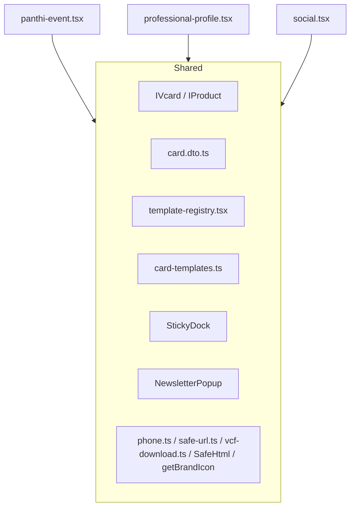

# Taprevia — Profile Template Architecture & Data Preservation Audit

**Date:** 2026-11-18 · **Mode:** Read-only · **Scope:** 3 public profile templates + shared infrastructure

---

## 1. Executive Summary

Taprevia has **three customer-facing profile templates** — `panthi-event` (default), `professional-profile`, and `social` — registered in two manually-synced lists. All profile-card products (Business NFC, Premium NFC, BPS linked Card) share the same template choices via a single account-level allowlist. Template switching is **data-safe**: the builder autosave sends a *partial* PATCH of only dirty fields, so changing `templateKey` never touches profile/gallery/products/social/theme data.

**Confirmed issues:**
1. **Theme colors are preview-only** — `themeConfig` exists in the Card model and public DTO, but `updateCardSchema` does not accept it, so the builder silently drops it (`use-card-draft.ts:478`).
2. **Business hours are stored but never rendered** by any template.
3. **Gallery captions are stored but never rendered.**
4. **`modern-professional` is a dead template key** (a preview page exists, but no registry/metadata entry).

**Compliance verdict (R1–R4):** R1 ✅ · R2 ✅ · R3 ✅ (with caveats) · R4 ✅.

---

## 2. Scope and Methodology

Static code inspection of the three template components, the registry, the DTO, the editor save path, and the template-switching write path. No runtime/visual/browser testing was performed. Findings are marked **confirmed-by-code**, **confirmed-by-test**, or **not-verified** where appropriate.

---

## 3. Repository Baseline

| Item | Value |
|---|---|
| Branch | `Devlopment` |
| HEAD | `0a3a1bc` ("review ui completed") |
| Uncommitted modified | 2 (`src/lib/services/review-templates.ts`, `scripts/test-review-templates.ts`) |
| Staged / untracked | 0 / 0 |
| Test DB | `taprevia_local_debug` (local), disposable `taprevia_*_test` for integration tests |

---

## 4. Complete Three-Template Inventory

| Key | Component file | Registry entry | Metadata entry | Default |
|---|---|---|---|---|
| `panthi-event` | `src/components/public/templates/panthi-event.tsx` | ✅ | ✅ | ✅ (`DEFAULT_TEMPLATE_KEY`) |
| `professional-profile` | `src/components/public/templates/professional-profile.tsx` | ✅ | ✅ | |
| `social` | `src/components/public/templates/social.tsx` | ✅ | ✅ | |
| `modern-professional` | *(preview page only)* `src/app/preview/modern-professional/page.tsx:32` | ❌ | ❌ | — **dead key** |

Sources: `src/lib/card-templates.ts:20-45`, `src/components/public/template-registry.tsx:57-61`.

---

## 5. Architecture Diagrams

```mermaid
flowchart LR
  Editor[Builder TemplateTab] -->|setField templateKey| Draft[use-card-draft]
  Draft -->|PATCH /api/cards/:id| API[PATCH handler]
  API -->|card.templateKey = value| Card[(Card)]
  Card -->|toPublicRenderCardDto| DTO[PublicCardDto]
  DTO --> Renderer[PublicVcardRenderer]
  Renderer -->|CARD_TEMPLATES[key] ?? DEFAULT| Tpl[Template Component]
  Tpl --> Public[Public Page]
```



---

## 6. Individual Template Analysis

### 6.1 Panthi Event (`panthi-event.tsx`)
- **Sections:** hero cover, tagline, phone/email/website meta, product carousel, services, gallery, WhatsApp pricing enquiry, contact sheet, sticky bar.
- **Styling:** custom `.pep2-*` CSS classes bridged to `--v-accent`/`--v-bg` theme vars (`:14-16`).
- **State:** lightbox, exchange sheet (contact + VCF gate), lead form, VCF download.
- **Theme:** applies `themeConfig` via `--v-accent`/`--v-bg` (`:663`).
- **Confirmed gap:** no `businessHours`, no `gallery[].caption`, no `price` render.

### 6.2 Professional Profile (`professional-profile.tsx`)
- **Sections:** cover, logo identity, quick actions (call/WhatsApp/email/VCF), services, product/portfolio, gallery, WhatsApp enquiry.
- **Styling:** Tailwind classes + `INNER_LINK` constants; **hardcoded colors** (no `themeConfig` reference).
- **Confirmed gaps:** no `businessHours`, no `gallery[].caption`, no `price`, **theme ignored**.

### 6.3 Social (`social.tsx`)
- **Sections:** glassmorphic cover, circular avatar, contact actions, brand links.
- **Styling:** Tailwind + glassmorphic; **no `themeConfig` reference**.
- **Confirmed gaps:** no `businessHours`, no `gallery[].caption`, **theme ignored**.

---

## 7. Template Registry and Selection

- **Selector (customer):** `src/components/builder/tabs/template-tab.tsx` — fetches `GET /api/card-templates?cardId=`, writes `draft.templateKey` (`:82`), warns when the current template is no longer granted (`:65-71`).
- **Save API:** `PATCH /api/cards/[id]` validates `data.templateKey` against `availableTemplatesForUser(ownerId)` (`cards/[id]/route.ts:266-272`).
- **Selection:** `PublicVcardRenderer` (`template-registry.tsx:34-36`) → `CARD_TEMPLATES[vcard.templateKey] ?? CARD_TEMPLATES[DEFAULT_TEMPLATE_KEY]`.
- **Default:** `DEFAULT_TEMPLATE_KEY = 'panthi-event'` (`card-templates.ts:42`).
- **Invalid-key handling:** `safeTemplateKey()` falls back to the default (`card-templates.ts:53`); the renderer's `??` also falls back.
- **Builder preview:** `preview-panel.tsx:100-101` uses the same registry + fallback.

---

## 8. Template Switching Write-Path Audit (R4 — HIGH PRIORITY)

**Confirmed data-safe.** The builder autosave (`use-card-draft.ts:432-521`) sends a **partial PATCH containing only dirty "owner" fields**:

```ts
const owners = Array.from(dirtyRef.current);          // only changed fields
for (const owner of owners) {
  if (owner === 'themeConfig' && !themeSupportedRef.current) continue;
  payload[owner] = jsonClone(canonicalOwnerValue(owner, current));
}
```

`setField('templateKey', key)` marks only `templateKey` dirty, so the PATCH body is `{ templateKey }`. The PATCH handler updates only `card.templateKey` and calls `card.save()` (partial update). **No full-document replacement, no field reset, no media/social/product/theme mutation.**

**Data-loss scenarios: NONE identified.** Switching templates changes presentation only.

---

## 9. Data Preservation Assessment (R4)

| Concern | Verdict |
|---|---|
| Only `templateKey` updated? | ✅ (dirty-tracking + partial PATCH) |
| Entire Card replaced? | ✅ No (handler mutates individual fields) |
| Omitted fields lost? | ✅ No (PATCH sends only dirty owners) |
| Nested objects overwritten? | ✅ No (only `templateKey` is a scalar) |
| Theme reset? | ✅ No (`themeConfig` excluded from save entirely) |
| Gallery/products/services/socials lost? | ✅ No |
| Legacy fields preserved? | ✅ No full replace |
| BPS linked Card affected? | ✅ No (same PATCH path) |
| Ownership/authorization checked? | ✅ `getOwnedCard` + `availableTemplatesForUser` |
| Race condition? | ⚠️ Debounced autosave is serialized by `savingRef` (`:450`); concurrent profile-data save + template switch both use the same partial-PATCH path — **no destructive overwrite observed** |

---

## 10. Complete Field Rendering Matrix

Legend: ✅ rendered · ❌ not rendered · ⚠️ partial · — N/A

| Field | Storage | DTO | Panthi | Professional | Social |
|---|---|---|---|---|---|
| Business name / person name / designation | `Card.name`/`basic` | ✅ | ✅ | ✅ | ✅ |
| Primary phone | `basic.phone` | ✅ | ✅ (tel) | ✅ (tel) | ✅ |
| Alternate phone | `basic.alternatePhone` | ✅ | ✅ | ✅ | ⚠️ |
| Email | `basic.email` | ✅ | ✅ | ✅ | ✅ |
| Website | social link | ✅ | ✅ | ✅ | ✅ |
| Address / Google Maps | `basic`/social | ✅ | ⚠️ | ⚠️ | ⚠️ |
| About / bio / company | `basic.about` | ✅ | ✅ | ✅ | ✅ |
| Profile image / logo | `profileImageUrl` | ✅ | ✅ | ✅ | ✅ |
| Cover image | `coverValue` | ✅ | ✅ | ✅ | ✅ |
| Social links | `socialLinks` | ✅ | ✅ | ✅ | ✅ |
| **Business hours** | `businessHours` | ✅ (`card.dto.ts:315`) | ❌ | ❌ | ❌ |
| Services | `services`/products | ✅ | ✅ | ✅ | ✅ |
| Products / catalogue | `products` | ✅ | ✅ | ✅ | ✅ |
| **Product pricing** | `IProduct.priceMinor` | ✅ | ❌ (enquiry) | ❌ (enquiry) | ❌ |
| Portfolio / gallery | `gallery` | ✅ | ✅ | ✅ | ✅ |
| **Gallery captions** | `galleryImages[].caption` | ✅ (`card.dto.ts:336`) | ❌ | ❌ | ❌ |
| **Theme colors** | `themeConfig` | ✅ (`card.dto.ts:277,280`) | ✅ | ❌ | ❌ |

**Key:** the DTO exposes `businessHours`, `galleryImages[].caption`, and `themeConfig`, but only `panthi-event` consumes `themeConfig`; no template consumes `businessHours` or captions.

---

## 11. Automatic Update Behavior (R3)

- `templateKey` references a **code-registered component** (no DB version). A code deploy updates all customers using that template automatically.
- **No template version stored**; no per-template legacy fork — old customers always render current template code.
- **Optional fields are `undefined`-safe:** DTO uses `pickObject`/`pickRows` (`card.dto.ts:277,315,335-336`); templates use `??` fallbacks. New fields default to empty and render nothing (blank sections are guarded by conditional rendering).
- **No migration needed** for new optional fields.

---

## 12. Product Template Availability Matrix (R2)

`availableTemplatesForUser` (`src/lib/services/template-access.ts:10-23`): account-level `SystemSettings` allowlist, default `DEFAULT_ALLOWED_TEMPLATES` (all 3), filtered by `isRegisteredTemplate`.

| Product | Templates offered | Selection | Entitlement |
|---|---|---|---|
| Business NFC Card | all 3 | same registry | `profile_edit` capability |
| Premium NFC Card | all 3 | same registry | `profile_edit` |
| BPS linked Card (`kind:'profile'`) | all 3 | same registry | `profile_edit` |
| Review Card (`kind:'review'`) | (rendered via review host, not profile template) | n/a | `review_ai_suggestions` |

**R2 satisfied:** template choice is not product-specific; product entitlement (`kindToKey` at `cards/[id]/route.ts:277`) remains separately enforced.

---

## 13. Shared Dependencies

| Dependency | Path | Role |
|---|---|---|
| `IVcard` / `IProduct` | `public/types.ts` | public render contract |
| `toPublicRenderCardDto` | `lib/dto/card.dto.ts` | public/private field separation |
| `CARD_TEMPLATES` | `template-registry.tsx:57` | component registry |
| `CARD_TEMPLATE_META` | `lib/card-templates.ts:20` | names/descriptions/default |
| `StickyDock` / `NewsletterPopup` | `public/` | shared dock/popup |
| `phone.ts`, `safe-url.ts`, `vcf-download.ts`, `SafeHtml`, `getBrandIcon` | `lib/` | contact actions, safety, VCF |

---

## 14. Security Assessment

| Area | Verdict |
|---|---|
| Public/private separation | ✅ `toPublicRenderCardDto` uses `pickObject`/`pickRows` (whitelist) |
| Safe HTML | ✅ `SafeHtml` sanitizer used for rich text |
| External URLs | ✅ `isSafeExternalUrl`/`safeExternalUrl` gates links |
| Phone | ✅ E.164 via `phone.ts` (`telHref`/`whatsappHref`/`vcfPhone`) |
| Ownership | ✅ `getOwnedCard` + capability checks on PATCH |
| Template entitlement | ✅ `availableTemplatesForUser` + `cards/[id]` 403 on ungranted key |
| Cross-customer isolation | ✅ no shared mutable template state |

No confirmed security defects. **Risk:** `CARD_TEMPLATE_META` and `CARD_TEMPLATES` are two manually-synced lists — divergence could cause a granted-but-unregistered key to silently fall back to the default.

---

## 15. Backward Compatibility

- Existing NFC/Premium/BPS cards: render current template code (no version fork).
- Public URLs, `/r/{routeSlug}`, QR/NFC resolution, VCF, analytics: untouched by template changes.
- Legacy template keys fall back safely (`safeTemplateKey`, renderer `??`).
- BPS canonical URL `/{business}/business-profile`: unaffected.

---

## 16. One-Template-One-File Compliance (R1)

✅ Each template is a single self-contained component file with its own JSX, styling, and sections; no template imports another. Adding a new template requires no edits to existing templates.

---

## 17. Fourth Template Development Guide

1. Create `src/components/public/templates/my-template.tsx` — component signature `({ vcard: IVcard, products: IProduct[] }) => ReactNode`.
2. Register in `CARD_TEMPLATES` (`template-registry.tsx:57-61`).
3. Add metadata to `CARD_TEMPLATE_META` (`card-templates.ts:20-39`).
4. (Optional) add preview page `src/app/preview/my-template/page.tsx`.
5. No entitlement change (default allowlist includes all keys).
6. No edits to existing template files.

---

## 18. Business Hours Readiness

- **Storage:** `Card.businessHours: IBusinessHour[]` (`types/index.ts:246`).
- **DTO:** ✅ `businessHours` (`card.dto.ts:315`).
- **Templates:** ❌ none render it.
- **Recommended placement:** a "Business Hours" section in each template, handling `enabled:false`/missing `from`/`to` (closed days).
- **Regression risk:** low (additive render of an already-exposed field).

---

## 19. Theme Support Readiness

- **Storage:** `Card.themeConfig` (`types/index.ts:15,226`); DTO ✅ (`card.dto.ts:277,280`).
- **Save path:** ❌ **blocked** — `updateCardSchema` does not accept `themeConfig`; the builder detects the failed save and shows "Theme colours are preview-only" (`use-card-draft.ts:470-482`).
- **Rendering:** ✅ `panthi-event` uses `--v-accent`/`--v-bg`; ❌ `professional-profile`/`social` hardcode colors.
- **Fix scope:** add `themeConfig` to `updateCardSchema` + PATCH write; then map `--v-*` vars in the other two templates.

---

## 20. Gallery Caption Readiness

- **Storage:** `Card.galleryImages[].caption` / `gallery[].caption` (`types/index.ts:224`).
- **DTO:** ✅ `galleryImages[].caption` (`card.dto.ts:336`).
- **Templates:** ❌ none render `caption`.
- **Fix scope:** render `caption` under each gallery image, guarded for missing/empty values.

---

## 21. Testing Coverage and Gaps

Existing tests cover: template metadata/default (`test-dashboard-entitlement.ts` reads `CARD_TEMPLATE_META`), DTO safety, phone/VCF, public URL display. **Gaps:**
- No test asserts `businessHours`/`caption`/`themeConfig` reach the templates.
- No test asserts switching `templateKey` preserves other fields (R4 regression guard).
- No test for the dead `modern-professional` key.

---

## 22. Confirmed Issues

| # | Issue | Severity | Evidence |
|---|---|---|---|
| 1 | `themeConfig` not saveable (preview-only) | P1 | `use-card-draft.ts:478` |
| 2 | Business hours stored but never rendered | P1 | no template ref; DTO `card.dto.ts:315` |
| 3 | Theme ignored by `professional-profile`/`social` | P1 | no `themeConfig` ref in those files |
| 4 | Gallery captions stored but never rendered | P2 | no template ref; DTO `card.dto.ts:336` |
| 5 | Dead `modern-professional` key | P3 | `app/preview/modern-professional/page.tsx:32` vs no registry/meta entry |

---

## 23. Potential Risks

- Two manually-synced lists (`CARD_TEMPLATE_META` vs `CARD_TEMPLATES`) can diverge.
- No shared design system (`.pep2-*` vs Tailwind vs glassmorphic) → visual drift.
- No `themeConfig` save schema → theme data silently dropped with a one-time toast.

---

## 24. Recommended Architecture Improvements (proposals only)

1. Derive `CARD_TEMPLATE_META` keys from `CARD_TEMPLATES` (single source of truth).
2. Remove or register the orphaned `modern-professional`.
3. Add `themeConfig` to `updateCardSchema` + PATCH write.
4. Extract shared section components (business hours, gallery captions) so all templates render new fields consistently.

---

## 25. Prioritized Implementation Roadmap

| Priority | Task |
|---|---|
| P0 | None blocking |
| P1 | Add `themeConfig` to save schema; render business hours + theme in all 3 templates |
| P2 | Render gallery captions |
| P3 | Remove/register dead `modern-professional`; single-source-of-truth registry |

---

## 26. Final Verdict Against R1–R4

| Requirement | Verdict | Notes |
|---|---|---|
| R1 — Independent template design | ✅ | one file per template; no cross-imports |
| R2 — Universal template availability | ✅ | account-level allowlist, all products share choices |
| R3 — Automatic updates + optional fields | ✅ | code-registered (auto-update); DTO/templates `undefined`-safe |
| R4 — Data preservation on switch | ✅ | dirty-tracked partial PATCH; no data loss path found |

**Confirmed data-loss risks: NONE.**

**Major limitations:** theme save is blocked; business hours/captions not rendered; two-list registry.

**Next steps:** approve P1 (theme save schema + business-hours/theme rendering), then P2 (captions), then P3 (registry cleanup).

---

## 27. Appendix — File / Function / Line References

- `src/lib/card-templates.ts:20-45` — `CARD_TEMPLATE_META`, `DEFAULT_TEMPLATE_KEY`, `safeTemplateKey`.
- `src/components/public/template-registry.tsx:34-36,57-61` — renderer fallback + `CARD_TEMPLATES`.
- `src/components/public/templates/{panthi-event,professional-profile,social}.tsx` — template components.
- `src/components/builder/tabs/template-tab.tsx:82` — `setField('templateKey', …)`.
- `src/lib/hooks/use-card-draft.ts:432-521` — dirty-tracked partial-PATCH autosave; `:478` themeConfig blocked.
- `src/app/api/cards/[id]/route.ts:266-272` — templateKey entitlement gate.
- `src/lib/services/template-access.ts:10-23` — `availableTemplatesForUser`.
- `src/lib/dto/card.dto.ts:277,280,315,335-336` — DTO exposure of themeConfig/businessHours/captions.
- `src/types/index.ts:15,224,226,246,329,361` — model fields.
- `src/app/preview/modern-professional/page.tsx:32` — dead key reference.
